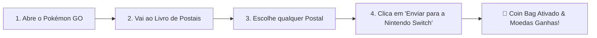

# 🪙 PoGo Coin Bag

Obtém o teu **Coin Bag (Saco de Moedas)** no Pokémon GO todos os dias para apanhar o **Gimmighoul**, apanhar **Gimmighoul Coins** e desbloquear o **Golden Lure Module** sem precisares de ter uma consola Nintendo Switch!

---

## 🌟 Créditos

> [!IMPORTANT]
> **Todo o mérito deste projeto pertence a [@na-ji](https://github.com/na-ji)** no projeto original [`pokemon-go-coin-bag`](https://github.com/na-ji/pokemon-go-coin-bag).
>
> Foi ele quem teve todo o trabalho de descobrir e criar como isto funciona.
> 
> 🌐 **Podes usar a versão Web diretamente no teu browser aqui:** [https://na-ji.github.io/pokemon-go-coin-bag/](https://na-ji.github.io/pokemon-go-coin-bag/)

---

## 💰 Como Ganhar Moedas e Ativar o Coin Bag

Para ativares o Coin Bag e ganhares moedas no Pokémon GO só precisas de **enviar 1 postal por dia** para uma das opções abaixo:

---

## 📲 Escolhe como queres usar

Podes usar qualquer uma das opções abaixo para receber o teu postal diário:

### Opção 1: No Computador / Browser (Mais Rápido)
1. Abre o link no teu PC/Mac (no Chrome ou Edge com Bluetooth ligado): **[https://na-ji.github.io/pokemon-go-coin-bag/](https://na-ji.github.io/pokemon-go-coin-bag/)**.
2. Clica no botão no site para procurar o telemóvel.
3. No Pokémon GO, envia o teu postal para a Nintendo Switch.

---

### Opção 2: Com uma placa ESP32 (A mais prática para o dia a dia)
*Se tiveres uma pequena placa ESP32, ela funciona como uma "Switch de bolso" que podes ligar a qualquer carregador USB:*
1. Instala o ficheiro na placa: [Download Firmware ESP32 (.zip)](https://github.com/TSGouveia/PoGo-Coin-Bag/releases/download/esp32-v1.0.0/pogo-coin-bag-esp32-firmware.zip).
2. Liga o ESP32 a uma porta USB ou powerbank (ele liga-se logo sozinho, não precisas de carregar em nenhum botão).
3. No Pokémon GO:
   - *(Apenas na 1ª vez)* Vai a **Definições > Dispositivos Conectados e Serviços > Nintendo Switch > Conectar à Nintendo Switch**.
   - Depois vai ao teu **Livro de Postais**, escolhe um postal e toca em **Enviar para a Nintendo Switch**.
4. O LED da placa fica fixo a confirmar o sucesso e o Coin Bag abre no jogo!

---

### Opção 3: Num segundo telemóvel (App Android)
1. Instala a app num segundo telemóvel: [Download APK Android](https://github.com/TSGouveia/PoGo-Coin-Bag/releases/download/android-v1.0.0/pogo-coin-bag-android.apk).
2. Abre a app e deixa-a aberta.
3. No teu telemóvel onde jogas Pokémon GO, vai aos teus Postais e clica em **Enviar para a Nintendo Switch**.

---

### Opção 4: No Smartwatch (Wear OS)
1. Instala a app no teu relógio Wear OS: [Download APK Wear OS](https://github.com/TSGouveia/PoGo-Coin-Bag/releases/download/wear-os-v1.0.0/pogo-coin-bag-wearos.apk).
2. Abre a app no relógio.
3. No telemóvel, vai aos Postais e envia para a Nintendo Switch.

---

## 🎁 Recompensas no Pokémon GO

* **1º Envio diário:** Recebes o **Coin Bag (Saco de Moedas)** que funciona como um Incenso durante 30 minutos atraindo Gimmighoul (Roaming Form).
* **Apanhar Gimmighoul:** Dá-te **Gimmighoul Coins** e doces.
* **Envios repetidos:** Cada dia que envias um postal, reativas o Coin Bag.
* **A cada 5 postais enviados:** Recebes um **Golden Lure Module (Módulo Atraente Dourado)** para transformar PokéStops em douradas e ganhar ainda mais moedas!
