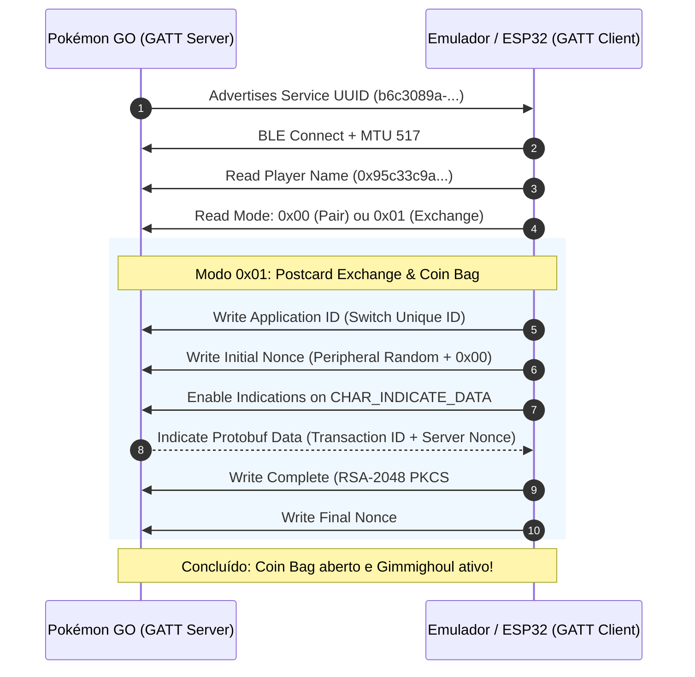

# 🪙 PoGo Coin Bag & Switch Emulator Suite

Emulador completo do handshake Bluetooth Low Energy (BLE) da **Nintendo Switch** (*Pokémon Scarlet & Violet*) para o **Pokémon GO**. Permite enviar postais diários para ativar o **Coin Bag (Saco de Moedas)** e atrair o **Roaming Form Gimmighoul** (e obter Gimmighoul Coins / Golden Lure Modules) sem necessitar de uma consola Nintendo Switch física.

---

## 🌟 Créditos e Agradecimentos Especiais

> [!IMPORTANT]
> **Todo o mérito da engenharia reversa, análise do protocolo criptográfico e implementação inicial pertence a [@na-ji](https://github.com/na-ji)** no projeto original [`pokemon-go-coin-bag`](https://github.com/na-ji/pokemon-go-coin-bag).
>
> Foi ele quem fez o trabalho árduo de dissecar a comunicação BLE proprietária da Nintendo Switch com o Pokémon GO, os pacotes Protobuf, as chaves RSA-2048 e as etapas de handshake (`0x00` pairing e `0x01` postcard exchange).
>
> 🌐 **Experimenta a versão Web online oficial:** [https://na-ji.github.io/pokemon-go-coin-bag/](https://na-ji.github.io/pokemon-go-coin-bag/)

---

## ⚠️ Nota Importante sobre Conexão no Mesmo Telemóvel

> [!WARNING]
> Devido a uma limitação arquitetural dos chips Bluetooth e da stack do Android (**ausência de loopback BLE local**), **uma aplicação não se pode conectar a si mesma por BLE no mesmo telemóvel**. 
> - **Se quiseres usar no telemóvel onde jogas Pokémon GO sem precisar de um segundo telemóvel:** Usa o **[Firmware ESP32](#3-esp32-arduino)** (uma placa de ~3€ ligada a qualquer porta USB/carregador).
> - **Se tiveres dois dispositivos:** Podes usar a app **Android**, o **Wear OS** ou a versão **Web** num segundo aparelho/PC.

---

## 🚀 Plataformas Disponíveis

| Plataforma | Descrição | Ficheiro de Instalação / Link |
| :--- | :--- | :--- |
| **ESP32 (Arduino)** | 🔌 **Modo Plug & Play Autónomo**. Liga-se via USB e faz handshake contínuo automático. | [Download Firmware (.zip)](https://github.com/TSGouveia/PoGo-Coin-Bag/releases/download/esp32-v1.0.0/pogo-coin-bag-esp32-firmware.zip) |
| **Android App** | 📱 App nativa Android (Kotlin / Jetpack Compose) com histórico de postais e multi-conta. | [Download APK](https://github.com/TSGouveia/PoGo-Coin-Bag/releases/download/android-v1.0.0/pogo-coin-bag-android.apk) |
| **Wear OS** | ⌚ App dedicada para Smartwatches Wear OS. Troca postais a partir do pulso. | [Download Wear APK](https://github.com/TSGouveia/PoGo-Coin-Bag/releases/download/wear-os-v1.0.0/pogo-coin-bag-wearos.apk) |
| **Web (Chrome / Edge)**| 🌐 Funciona direto no browser com Web Bluetooth API (PC/Mac/Android). | [Abrir Web App](https://na-ji.github.io/pokemon-go-coin-bag/) ou [Download Zip](https://github.com/TSGouveia/PoGo-Coin-Bag/releases/download/web-v1.0.0/pogo-coin-bag-web.zip) |

---

## 📖 Instruções de Utilização

### 1. ESP32 (Arduino) — *Recomendado (Plug & Play Autónomo)*
* **Hardware suportado:** Qualquer placa ESP32 (ESP32 Dev Module, ESP32-WROOM, WROVER, S3).
* **Comportamento:** O código foi otimizado para **conexão automática imediata**. Basta ligar o ESP32 à tomada/powerbank/USB e ele começa imediatamente a escutar.
* **Passos:**
  1. Instala o [Arduino IDE](https://www.arduino.cc/en/software) com o pacote `esp32` da Espressif.
  2. Abre a pasta `esp32-arduino/esp32_pogo_coin_bag/esp32_pogo_coin_bag.ino`.
  3. Faz o flash / upload para a tua placa ESP32.
  4. No Pokémon GO: vai a **Definições > Dispositivos Conectados e Serviços > Nintendo Switch > Conectar à Nintendo Switch** (apenas na 1ª vez).
  5. Vai ao teu **Livro de Postais**, escolhe qualquer postal e toca em **Enviar para a Nintendo Switch**.
  6. O LED do ESP32 indicará o progresso e ficará aceso fixo por 5 segundos confirmando o sucesso!

### 2. Android App
1. Descarrega e instala o [`pogo-coin-bag-android.apk`](https://github.com/TSGouveia/PoGo-Coin-Bag/releases/download/android-v1.0.0/pogo-coin-bag-android.apk) num **segundo telemóvel**.
2. Concede as permissões de Bluetooth / Nearby Devices.
3. A app entra em modo de escuta contínuo e exibe o log dos postais recebidos e nomes dos treinadores.
4. No teu telemóvel com Pokémon GO, envia o postal para a Nintendo Switch.

### 3. Wear OS
1. Instala o [`pogo-coin-bag-wearos.apk`](https://github.com/TSGouveia/PoGo-Coin-Bag/releases/download/wear-os-v1.0.0/pogo-coin-bag-wearos.apk) no teu smartwatch Wear OS (via ADB wireless ou ferramentas como Bugjaeger / Wear Installer).
2. Abre a app no relógio; ela iniciará o serviço BLE em background.
3. No Pokémon GO do telemóvel, conecta e envia o postal.

### 4. Versão Web
1. Acede a [https://na-ji.github.io/pokemon-go-coin-bag/](https://na-ji.github.io/pokemon-go-coin-bag/) através do Google Chrome, Microsoft Edge ou Opera com Bluetooth ativo.
2. Clica no botão para iniciar a conexão e seleciona o Pokémon GO na lista de emparelhamento BLE.

---

## 🛠️ Como Funciona o Protocolo

---

## 📜 Licença

Distribuído sob a licença MIT. Consulta o ficheiro [LICENSE](LICENSE) para mais detalhes.

Agradecimento mais uma vez a **[@na-ji](https://github.com/na-ji)** pela criação e engenharia deste emulador extraordinário!
